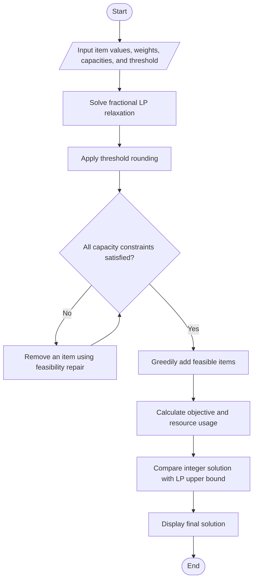

# Threshold Rounding Algorithm for Multidimensional Knapsack

## Description

This project implements a Threshold Rounding Algorithm for the 0/1 Knapsack Problem with multiple capacity constraints using Python. It solves a fractional Linear Programming (LP) relaxation and converts the fractional solution into an integer solution using threshold rounding, feasibility repair, and greedy augmentation.

## Features

- Supports multiple capacity constraints.
- Solves the fractional LP relaxation using SciPy.
- Applies configurable threshold rounding.
- Repairs capacity violations using a feasibility heuristic.
- Improves the solution through greedy augmentation.
- Compares the integer objective value with the fractional LP upper bound.
- Reports resource utilization and feasibility.

## Technologies

- Python
- NumPy
- SciPy
- Linear Programming
- Approximation Algorithms
- Threshold Rounding

## Requirements

- Python 3.x
- NumPy
- SciPy

## Suggested Project Folder Structure

```text
Threshold_Rounding_Multidimensional_Knapsack/
├── main.py
└── README.md
```

## Algorithm

1. Input item values, resource weights, capacity limits, and the threshold.
2. Formulate the fractional LP relaxation of the multidimensional knapsack problem.
3. Solve the LP relaxation to obtain fractional decision variables.
4. Select items whose fractional values meet the specified threshold.
5. Check all capacity constraints.
6. Remove items using a feasibility-repair heuristic until the solution is feasible.
7. Greedily add remaining items whenever all capacity constraints remain satisfied.
8. Calculate the final objective value and resource utilization.
9. Compare the integer solution with the fractional LP upper bound.
10. Display the final solution and feasibility status.

## Algorithm Flowchart

### Text-drawn flowchart

```text
                    ┌─────────────┐
                    │    START    │
                    └──────┬──────┘
                           │
                           ▼
       ┌─────────────────────────────────────┐
       │ Input item values, weights,         │
       │ capacities, and threshold           │
       └──────────────────┬──────────────────┘
                          │
                          ▼
       ┌─────────────────────────────────────┐
       │ Solve fractional LP relaxation      │
       └──────────────────┬──────────────────┘
                          │
                          ▼
       ┌─────────────────────────────────────┐
       │ Apply threshold rounding            │
       └──────────────────┬──────────────────┘
                          │
                          ▼
                ◇─────────────────────◇
               / All capacity constraints \
               \       satisfied?         /
                ◇──────────┬──────────◇
                    No     │     Yes
                     │     │
                     ▼     │
       ┌─────────────────────────────┐
       │ Remove an item using        │
       │ feasibility repair          │
       └──────────────┬──────────────┘
                      │
                      └─────────────── back to decision
                            │
                            ▼
       ┌─────────────────────────────────────┐
       │ Greedily add feasible items         │
       └──────────────────┬──────────────────┘
                          │
                          ▼
       ┌─────────────────────────────────────┐
       │ Calculate objective and             │
       │ resource usage                      │
       └──────────────────┬──────────────────┘
                          │
                          ▼
       ┌─────────────────────────────────────┐
       │ Compare integer solution with       │
       │ LP upper bound                      │
       └──────────────────┬──────────────────┘
                          │
                          ▼
       ┌─────────────────────────────────────┐
       │ Display final solution              │
       └──────────────────┬──────────────────┘
                          │
                          ▼
                    ┌─────────────┐
                    │     END     │
                    └─────────────┘
```

### Mermaid flowchart

GitHub also renders this Mermaid diagram as a visual flowchart when you view the README.



## Expected Output

```text
THRESHOLD ROUNDING: MULTIDIMENSIONAL KNAPSACK

Threshold: 0.50
Number of items: 5
Number of constraints: 3

Fractional LP solution:
  Item 1: x = ...
  Item 2: x = ...
  Item 3: x = ...
  Item 4: x = ...
  Item 5: x = ...

Rounded 0/1 solution:
  Item 1: SELECTED / NOT SELECTED
  Item 2: SELECTED / NOT SELECTED
  Item 3: SELECTED / NOT SELECTED
  Item 4: SELECTED / NOT SELECTED
  Item 5: SELECTED / NOT SELECTED

Resource utilization:
  Weight: used / capacity
  Time: used / capacity
  Energy: used / capacity

Objective comparison:
  Rounded integer value: ...
  Fractional LP upper bound: ...
  LP-relative value ratio: ...

Feasible: True
```

*Note: The numerical values depend on the LP solver's fractional solution and the rounding procedure. The output above is a template, not a literal program run.*

## Complexity Analysis

Let `n` be the number of items and `m` be the number of capacity constraints.

| Operation | Complexity |
|---|---|
| LP relaxation | Depends on the LP solver and instance |
| Threshold rounding | O(n) |
| Feasibility repair | O(n²m) in the worst case |
| Greedy augmentation | O(n log n + nm) |
| Overall rounding phase | O(n²m + n log n) |

## Limitations

- Threshold rounding is a heuristic and does not guarantee an optimal integer solution.
- The greedy augmentation step improves the result but does not guarantee global optimality.
- A fixed approximation ratio is not guaranteed for arbitrary multidimensional knapsack instances.
- The fractional LP objective provides an upper bound on the optimal integer objective for this maximization problem.

## How to Run

Run the main Python program:

```bash
python main.py
```

## Author

Amrit Kumar Jena
